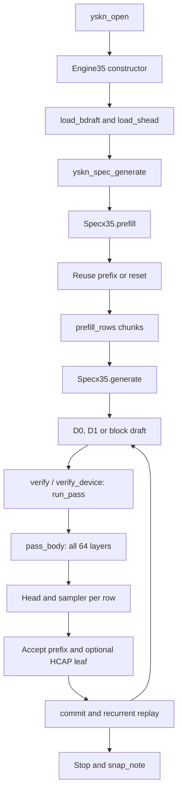

# Shipping upstream execution path

## Scope and evidence

This specification describes source commit `758ef28e307521e1ceb006ddbe895e909910b1ad`. Its starting point is a text generation request using `RuntimeProfile.default`, `DEFAULT_SPEC`, a main container whose `arch` is `qwen3_5`, and the build definition `YSKN_KVX_MODE=3`. The C API constructs `Engine35` for that architecture. `Engine` is not the model executor. Container layout is specified separately in [FORMAT.md](../FORMAT.md). (`python/yasakani/runtime.py:27-59,83-100`; `src/c_api.cpp:15-18`; `CMakeLists.txt:46`; `src/format.hpp:29-48`.)

The runtime removes every existing `YSKN_` variable not present in its profile before opening the engine. Therefore an experiment enabled in a developer's shell does not silently become part of this path. Explicit runtime overrides and later option changes can select other behavior; the tables below distinguish an absent-variable default from the shipping value. (`python/yasakani/runtime.py:83-100`.)

The requested bit-exact reference has real source-only limits: vendor elementary functions, tensor-core instruction internals, and a shortlist race are not completely determined by these files. Those limits are identified where used and collected in [OPEN_QUESTIONS.md](../spec/OPEN_QUESTIONS.md). No CUDA execution or model-payload inspection is claimed. The executable reads layer types and some dimensions from the model; the documented 64-layer map is corroborated by committed tensor inventories, as explained in [01_MODEL_ARCHITECTURE.md](../spec/01_MODEL_ARCHITECTURE.md). (`src/q35_kernels.cu:42-44,113-116`; `src/q35_atxpk.cu:35-37`; `src/q35_bdraft.cu:882-896`; `src/engine35.cpp:214-236`.)

Two easy-to-miss reachability facts:

- `lfrow=0` disables the older MTP leaf-selection branch, but **does not disable HCAP**. Loading the block drafter enables HCAP by default; speculative generation temporarily sets engine option 6 to 1 for it. Tree-aware recurrence, attention masks and row promotion are live. (`src/engine35.cpp:1689-1693`; `src/specx.cpp:193-198,357-365,415-423`.)
- `prefill_head=1` calls `prefill_rows`, even for long prompts. The configured `LAYER_ROWS=4096` and `LAYER_OVERLAP=1` do not select `prefill_vsp` in this request path. Large-row compressed arithmetic is still live through `prefill_rows` → `run_pass`. (`src/specx.cpp:110-118`; `src/engine35.cpp:982-986,1244-1266`; `python/yasakani/runtime.py:32-35,59`.)

## One request: call graph and state transitions

This graph omits scheduling mechanisms that do not define a different mathematical operation. Detailed scalar algorithms are in the linked topic documents. Graph replay invokes the same `pass_body` captured by `run_pass`; it does not introduce a separate model. (`src/engine35.cpp:964-975`.)



The edges and the omitted setup are resolved in this table. “Position” counts input tokens whose state has been committed; the next sampled token is pending input. (`src/engine35.cpp:1244-1266,1300-1329`; `src/specx.cpp:94-126,398-432`.)

| Stage | Calls and observable work | Evidence |
|---|---|---|
| Python setup | Resolve model-folder paths; apply profile; open native engine; load block drafter. Sampling is configured separately from `DEFAULT_ENV`/`DEFAULT_SPEC`. | `python/yasakani/runtime.py:83-100,119-152`; `python/yasakani/engine.py:92-114,166-176` |
| Open | `yskn_open` reads `arch`, constructs `Engine35`; constructor checks hardcoded shape constraints, loads KV profile, tensors, signs, normalization weights and embedding, allocates state, and builds RoPE table. | `src/c_api.cpp:15-18`; `src/engine35.cpp:184-225,236-299,314-365` |
| Draft setup | `load_bdraft` loads five draft layers and capture indices, optional subhead, SHEAD, and HCAP probability tables. `load_shead` parses the auxiliary head. | `src/engine35.cpp:1611-1697,1700-1739` |
| Request entry | C API decodes 44 configuration integers; constructs `Specx35`; calls `prefill` followed by `generate`. Returned slot 0 is the token selected by prefill, with subsequent generated tokens after it. | `src/c_api.cpp:37-75`; `python/yasakani/engine.py:213-228` |
| Prefix reuse | `SpecxT::prefill` chooses a matching live prefix, saved snapshot, or reset. It may split work after the last snapshot marker and save between segments. It learns D1 records from new prompt rows; D0 is rebuilt lazily from the complete sequence. | `src/specx.cpp:42-48,94-126`; `src/engine35.cpp:1547-1584` |
| Prefill | `prefill_rows` uploads up to `PM_=1024` rows, runs all layers with commit enabled and heads for every row, records top-8 predictions, adds captured main features to draft context, and advances position. | `src/engine35.cpp:1244-1266`; `src/engine35.cpp:194-213`; `python/yasakani/runtime.py:35,59` |
| Candidate generation | D0 copies a previous sequence continuation; D1 uses learned predictions; the five-layer block drafter supplies one-shot candidates when selected. Adaptive decisions choose 8 or 16 verification rows; HCAP can replace some 8-row linear-chain rows with alternatives. | `src/specx.cpp:31-93,203-365`; `src/engine35.cpp:1775-1870`; [08_SPECULATION.md](../spec/08_SPECULATION.md) |
| Verify | Host copy/table rows use `verify` to upload `[pending_token, proposed_tokens...]`; neural rows already reside in the draft buffer and use `verify_device`. Both call `run_pass` with all-row heads. Normally persistent recurrent state is unchanged, but provisional convolution/state inputs and KV entries are retained for commit. A one-row verification can commit state immediately. | `src/specx.cpp:357-373`; `src/engine35.cpp:1299-1317,1519-1538`; `src/engine35.hpp:364-368` |
| Layer loop | `pass_body` initializes embedding/residual normalization, then `layer(l,M,n_commit)` for every main layer. Selected layer outputs are captured for the draft model. | `src/engine35.cpp:824-841` |
| Head | Head rows are processed in groups of at most 16. `head_slice` runs the compressed `lm_head`, selects greedy or sampled tokens, and optionally returns top-8 values. | `src/engine35.cpp:802-821,834-839`; [06_OUTPUT_HEAD_SAMPLER.md](../spec/06_OUTPUT_HEAD_SAMPLER.md) |
| Accept | Compare each proposal against the main output of its parent row. Promote a matching HCAP leaf where allowed, then retain the matching prefix and one correction/bonus token. Truncate at EOS/request count according to the loop. | `src/specx.cpp:376-440`; `src/engine35.cpp:877-899` |
| Commit | `commit(a)` consumes `a+1` input rows, replays only GDN state/history if not already committed, advances position, and installs the selected next token. Main KV writes already exist; visibility is bounded by position and row ancestry. | `src/engine35.cpp:843-865,1319-1329`; `src/q35_atxpk.cu:390-409` |
| Draft context and end | Add newly committed captured features to draft context before its next use. On completion, `snap_note` records the committed sequence excluding its pending final token. | `src/specx.cpp:245-270,430-465`; `src/c_api.cpp:70-71`; `src/engine35.cpp:1767-1789,1838-1851` |

The scalar outline of one verification pass is below. Each helper is specified in the numbered topic documents; there is no implication that a conventional eager RMSNorm may replace the deferred normalization used by the compressed operators. (`src/engine35.cpp:403-429,749-841`; [02_COMPRESSED_LINEAR.md](../spec/02_COMPRESSED_LINEAR.md); [05_RESIDUAL_NORM_MLP.md](../spec/05_RESIDUAL_NORM_MLP.md).)

```text
verify(rows, base_position, parent_table):
    hidden = embedding(rows.input_token)
    activation = prepare_deferred_norm(hidden, first_layer.input_norm,
                                       first_layer.input_rotation_signs)
    for layer_index = 0 .. 63:
        if layer_kind[layer_index] == gated_delta:
            qkv, gate_z = compressed_project(activation, qkv_weights, z_weights)
            gate_a, gate_b = small_bfloat16_projections(hidden_side_copy)
            q, k, v = causal_convolution_and_normalize(qkv, parent_table)
            core = provisional_delta_recurrence(q, k, v, gate_a, gate_b,
                                                persistent_state, parent_table)
            mixer_output = gated_normalized_delta_output(core, gate_z)
        else:
            q, k, v, attention_gate = attention_projections(activation)
            q, k = head_normalization_and_rope(q, k, base_position, parent_table)
            write_provisional_kv(k, v)
            mixer_output = causal_attention_and_gate(q, attention_gate,
                                                    base_position, parent_table)
        hidden = rounded_residual_add(hidden, output_projection(mixer_output))
        activation = prepare_deferred_norm(hidden, layer.post_attention_norm,
                                           layer.mlp_gate_input_signs)
        gate, up = compressed_project(activation, gate_weights, up_weights)
        mlp_input = rounded_silu_product(gate, up)
        hidden = rounded_residual_add(hidden, down_projection(mlp_input))
        activation = prepare_next_layer_or_final_norm(hidden)
        if layer_index in [5,19,33,47,61]: capture(hidden)
    logits = output_head(activation)
    return select_each_row(logits, absolute_prediction_positions)
```

This is the documented 64-layer instance, not a new check imposed by the executable: its loop bound is `nlayers_` from the container. GDN/attention semantics, branch ancestry, cache precision and operation order are in [03_GATED_DELTANET.md](../spec/03_GATED_DELTANET.md) and [04_ATTENTION.md](../spec/04_ATTENTION.md). (`src/engine35.cpp:218,236-266,768-841,1650`; `src/engine35.hpp:237`.)

## Every file in `src/`

“Live” means at least one definition/declaration is used by the selected engine, including a supported data-dependent fallback; it does not mean every function in that file runs. “Debug/test only” means reachable through explicit diagnostics, not normal generation. “Dead” means the generation path above cannot select its numerical implementation under the shipping settings. Compiling a translation unit is not evidence of runtime reachability. (`CMakeLists.txt:13-44`; `src/c_api.cpp:15-18,28-36,93-135`; `src/engine35.cpp:403-429,675-737`.)

| File | Verdict | Evidence and boundary |
|---|---|---|
| `src/a8_prologue.cuh` | Live | Activation quantization included/called by main kernels. `src/q35_kernels.cu:7,1421,1463` |
| `src/args.hpp` | Live | Linear launch structures included by Engine35. `src/engine35.hpp:18`; `src/engine35.cpp:403-429` |
| `src/attention_gqa.cu` | Dead | Older Engine attention; Engine35 dispatches q35 attention functions. `src/engine.cpp:188-204`; `src/engine35.cpp:711-732` |
| `src/attention_kv4q.cu` | Dead | Older 128-wide attention paths; same dispatch boundary. `src/engine.cpp:188-204`; `src/engine35.cpp:711-732` |
| `src/c_api.cpp` | Live | Architecture dispatch and request entry. `src/c_api.cpp:15-18,37-75` |
| `src/devmem.cpp` | Live | Engine35 allocation scope and release. `src/engine35.cpp:185,387`; `src/devmem.cpp:18-51` |
| `src/devmem.hpp` | Live | Allocation wrappers included by Engine35. `src/engine35.cpp:14,185`; `src/devmem.hpp:8-27` |
| `src/draft_kernels.cu` | Dead | Older Engine draft, not block draft. `src/engine.cpp:4,577-578`; `src/engine35.cpp:1775-1869` |
| `src/draft_kernels.hpp` | Dead | Declarations for older draft path. `src/engine.cpp:4`; `src/draft_kernels.hpp:6-14` |
| `src/engine.cpp` | Live, shared helper only | `g_pdl_rows` and `pdl_enabled` are used by Engine35 launches. Its `Engine` class is not selected. `src/engine.cpp:16-20`; `src/pdl.cuh:17-22`; `src/engine35.cpp:825`; `src/c_api.cpp:17-18` |
| `src/engine.hpp` | Dead model path | Included for alternative-engine declarations in C API/template compilation; no `Engine` instance on this architecture. `src/c_api.cpp:3,12-18`; `src/specx.hpp:20-21` |
| `src/engine35.cpp` | Live | Selected executor, load/prefill/verify/commit/draft. `src/c_api.cpp:17`; `src/engine35.cpp:1244-1266,1288-1329,1611-1697` |
| `src/engine35.hpp` | Live | Selected class, dimensions/state/options. `src/engine35.cpp:3`; `src/engine35.hpp:236-378` |
| `src/format.hpp` | Live | Container parsing in `Container::open`. `src/format.hpp:25-64`; `src/c_api.cpp:16`; `src/engine35.cpp:214` |
| `src/gemm_compressed.cu` | Dead | `launch_gemm` is called by older Engine; Engine35 explicitly chooses LNORD/PFA/G6. `src/engine.cpp:146,179,213`; `src/engine35.cpp:416-427` |
| `src/gemv_sigma_int.cu` | Dead generation path; tests can call | `launch_gemv` is older Engine/test wrapper; Engine35 directly calls LNORD. `src/engine.cpp:177`; `src/test_hooks.cpp:21,47,70`; `src/engine35.cpp:427` |
| `src/hcap_tables.inc` | Live | Loaded HCAP calibration table. `src/engine35.cpp:1690-1693`; `src/hcap_tables.inc:1-7` |
| `src/kernels.hpp` | Live | Shared tensor and launch declarations. `src/model.hpp:8`; `src/engine35.cpp:403-429` |
| `src/kvq_attn.cuh` | Debug/test only | Included by packed-cache probe, not main attention. `src/kvx_probe.cu:116-120`; `src/q35_atxpk.cu:3-11` |
| `src/kvq_atxpk.hpp` | Live | Builds profile decode records and packing eligibility. `src/engine35.cpp:20,45-53`; `src/kvq_atxpk.hpp:25-85` |
| `src/kvq_fast.cuh` | Live | Fast KV requantization selected by TB_FAST/TB_VIT2. `src/q35_kernels.cu:12`; `src/kvq_fast.cuh:238-251`; `src/engine35.cpp:51-53,704` |
| `src/kvq_fast.hpp` | Live | Profile-to-fast-encoder preparation. `src/engine35.cpp:19,51-53`; `src/kvq_fast.hpp:12-69` |
| `src/kvq_gpu.cuh` | Live | Profile decoder and generic group codecs included by fast encoder. `src/kvx_codec.cuh:16-17`; `src/q35_kernels.cu:3`; `src/kvq_gpu.cuh:10-149` |
| `src/kvq_vit2.cuh` | Live | Default Viterbi encoder specialization. `src/kvq_fast.cuh:236-249`; `python/yasakani/runtime.py:39` |
| `src/kvx_codec.cuh` | Live | Mode-3 signed rotation and byte-cache codec definitions. `src/q35_kernels.cu:3`; `src/kvx_codec.cuh:11-91`; `CMakeLists.txt:46` |
| `src/kvx_probe.cu` | Debug/test only | Standalone probe exports, not called by generation. `src/kvx_probe.cu:24-63,121-141`; `src/c_api.cpp:37-75` |
| `src/kz_common.cuh` | Dead | Integer-exponent attention/combine helpers require nonzero PMATH attention selector; shipping `kz_=0`. `src/q35_kernels.cu:1366-1397`; `src/engine35.hpp:289`; `src/engine35.cpp:715-720` |
| `src/lfrow_kernels.cuh` | Live | Tree-aware GDN and attention helpers used by HCAP, even with spec `lfrow=0`. `src/q35_kernels.cu:1578`; `src/specx.cpp:195-198`; `src/engine35.cpp:783-790,716` |
| `src/lnord.cu` | Live | <=16-row XSUM main linear operator and draft operator. `src/engine35.cpp:427,809,1764`; `src/lnord.cu:378-435` |
| `src/loader.cpp` | Live, shared upload | `upload_linear` used by Engine35; `Model::load` portion belongs to older Engine. `src/engine35.cpp:157`; `src/loader.cpp:10-62,64-95` |
| `src/mapped_file.hpp` | Live | Read-only container mapping. `src/format.hpp:12,25-30`; `src/mapped_file.hpp:18-102` |
| `src/misc_kernels.cu` | Live | Shared argmax/top-k and integer/verification setup helpers. `src/engine35.cpp:813,821,1288-1305`; `src/misc_kernels.cu:90-213` |
| `src/model.hpp` | Live | `Model`, `DevTensor` and container ownership reused by Engine35. `src/engine35.hpp:16,236`; `src/model.hpp:8-39` |
| `src/pdl.cuh` | Live, scheduling | Shared launcher; does not define a different scalar arithmetic formula. `src/pdl.cuh:7-24`; `src/engine.cpp:16-20` |
| `src/pfa.cu` | Live | >16-row compressed-body fallback, including 17..255 rows rejected by G6. `src/engine35.cpp:416-419`; `src/q35_g6.cu:310-312`; `src/pfa.cu:355-364` |
| `src/pm_math.cuh` | Dead shipping arithmetic | Portable elementary functions are in inactive `pm` branches; PM defaults off. Tests can call them. `src/engine35.cpp:458-465`; `src/q35_kernels.cu:42-44`; `src/q35_sample.cu:84,185`; `src/pm_test.cu:15-23` |
| `src/pm_test.cu` | Debug/test only | `yskn_pm_test` exported diagnostic. `src/pm_test.cu:30-52` |
| `src/post_kernels.cu` | Dead | Older Engine post-processing; main model uses q35 post kernels. `src/engine.cpp:109-111,201-223`; `src/engine35.cpp:749-765,798-800` |
| `src/post_kernels.hpp` | Live declarations | Shared argument declarations included by `args.hpp`; old post kernels themselves are inactive. `src/args.hpp:8`; `src/post_kernels.hpp:7-57` |
| `src/q35.hpp` | Live | Main/draft dimensions and numerical interfaces. `src/engine35.hpp:17`; `src/q35.hpp:6-20,172-219` |
| `src/q35_atx.cu` | Live, profile-dependent fallback | ATX for layers without packed streams, and other cache forms; engine calls it when `cap_ord<0`. `src/engine35.cpp:689-691,716-717,729`; `src/q35_atx.cu:796-836` |
| `src/q35_atxpk.cu` | Live | Packed attention dispatch/common functions. `src/engine35.cpp:716,729`; `src/q35_atxpk.cu:702-742` |
| `src/q35_atxpk.hpp` | Live | Packed-attention argument interface. `src/engine35.cpp:21,716`; `src/q35_atxpk.hpp:5-15` |
| `src/q35_atxpk3.cuh` | Live | Shipping PKV=3 selects pk3 for <=2 rows. `src/q35_atxpk.cu:729-732`; `python/yasakani/runtime.py:40-41` |
| `src/q35_atxpk4.cuh` | Live | Shipping PKV=3 selects pk4 for >2 rows with packed keys. `src/q35_atxpk.cu:734-737`; `python/yasakani/runtime.py:41` |
| `src/q35_bdraft.cu` | Live | Five-layer block draft, selector, HCAP and SHEAD. `src/engine35.cpp:1775-1869`; `src/q35_bdraft.cu:748-976` |
| `src/q35_chk.cu` | Debug/test only | Checksum hooks require populated checksum entries; ordinary loader does not populate them. `src/engine35.cpp:431-438,490-551`; `src/engine35.hpp:205-207` |
| `src/q35_fa.cu` | Dead | Alternative FA attention is bypassed while ATX=1, despite native FA default 1. `src/engine35.cpp:711-732`; `python/yasakani/runtime.py:37` |
| `src/q35_flow.cu` | Live setup only | `q35_flow_set_pm` is called at initialization; fused MLP body requires FLOW!=0 and is inactive. `src/engine35.cpp:462,796`; `src/q35_flow.cu:294`; `src/engine35.hpp:292-296` |
| `src/q35_flow.hpp` | Live declarations | PM setter and optional flow interface. `src/engine35.cpp:12,462`; `src/q35_flow.hpp:5-20` |
| `src/q35_g6.cu` | Live | Eligible >=256-row body projections use predecoded int8 weights. `src/engine35.cpp:314-320,416-419`; `src/q35_g6.cu:310-350` |
| `src/q35_g6.hpp` | Live | Workspace and dispatch interface. `src/engine35.hpp:19,249`; `src/q35_g6.hpp:5-16` |
| `src/q35_kernels.cu` | Live | Main normalization, embedding, recurrent, attention-post and residual kernels. `src/engine35.cpp:675-800,824-865` |
| `src/q35_kz.cu` | Dead | Alternative integer-exponent attention requires PMATH; incompatible with active packed KV. `src/engine35.cpp:677-679,715`; `src/engine35.hpp:289` |
| `src/q35_prefill.cu` | Dead in shipping request | Capture-quantization helper belongs to layer-major `prefill_vsp`, bypassed by `prefill_head=1`. `src/q35_prefill.cu:7-21`; `src/engine35.cpp:1116`; `src/specx.cpp:110-118` |
| `src/q35_sample.cu` | Live | Main sampler and fused head selection; sampling enabled by request options. `src/engine35.cpp:810-820,952-959`; `src/q35_sample.cu:209-215` |
| `src/repack.cu` | Live load | Weight repacking used by `upload_linear`. `src/loader.cpp:43`; `src/repack.cu:21-32` |
| `src/signs.hpp` | Live | Deterministic signs constructed at tensor/embedding load. `src/loader.cpp:34-36`; `src/engine35.cpp:284`; `src/signs.hpp:9-32` |
| `src/smp_hash.cuh` | Live | Position/token keyed sampler and draft coupling hash. `src/q35_sample.cu:5`; `src/q35_bdraft.cu:5`; `src/smp_hash.cuh:5-17` |
| `src/specx.cpp` | Live | Generation state machine, D0/D1, adaptive block selection, accept/commit. `src/c_api.cpp:70`; `src/specx.cpp:94-126,128-471` |
| `src/specx.hpp` | Live | Configuration and state definitions for `SpecxT<Engine35>`. `src/c_api.cpp:5,41-54,70`; `src/specx.hpp:23-133` |
| `src/test_hooks.cpp` | Debug/test only | Exported isolated compressed-kernel tests, not generation. `src/test_hooks.cpp:10-79` |
| `src/v2_decode.cuh` | Dead generation path | Decode helpers included by older GEMV/GEMM implementations. `src/gemv_sigma_int.cu:5`; `src/gemm_compressed.cu:3`; `src/engine35.cpp:416-427` |

## Environment-variable inventory

The inventory covers every environment read in `src/` and the shipped `python/yasakani/` package, including indirect names in the L2 prefetch array. Benchmark/build shell environments are not engine configuration. In the shipping column, `default` means the variable is absent after profile application and the adjacent native fallback applies; `inactive` means its code path is not reached. Explicit values in this column come from `DEFAULT_ENV` or `RuntimeProfile.default`. (`src/engine35.cpp:360-362`; `python/yasakani/runtime.py:27-44,83-100`.)

### Main engine and shared numerical backends

| Variable | Absent-variable default | Shipping value | What it changes; code evidence |
|---|---|---|---|
| `YSKN_TB_PROFILE` | None; mode 3 requires a path | Model pack `kv_profile` | KV profile tables, group policies and codec parameters. `src/engine35.cpp:31-55`; `python/yasakani/runtime.py:86` |
| `YSKN_TB_FAST` | 1 | default | Prepare/use fast profile encoder; TB_CAP requires it. `src/engine35.cpp:51-53,208` |
| `YSKN_TB_CAP` | 0 | 1 | Persist eligible compressed KV streams instead of only byte reconstructions. `src/engine35.cpp:205-208,689-704` |
| `YSKN_TB_VIT2` | 1 | 1 | Choose specialized trellis encoder for eligible groups. `src/kvq_fast.cuh:238-251` |
| `YSKN_Q35_SHARED_WEIGHTS` | 0 | 1 | Share immutable uploaded weights across compatible Engine35 instances. `src/engine35.cpp:57-109` |
| `YSKN_Q35_NW` | `down=9,out=4,o=4,gate=5,up=5,qkv=8,z=8,q=4,k=4,v=4` | default | Comma-separated per-role worker overrides; integer group sums remain the numerical contract. `src/engine35.cpp:122-134`; `src/lnord.cu:290-316` |
| `YSKN_Q35_RP_ASYNC` | 1 | default | Schedule commit replay separately; readers still fence it. `src/engine35.cpp:188,1319-1329`; `src/engine35.hpp:320-325` |
| `YSKN_RP_DEFER` | 0 | default | Delay replay submission until the next required fence. `src/engine35.cpp:189,1319-1329`; `src/engine35.hpp:323-325` |
| `YSKN_L2PF2` | 0 MiB | default | Optional second prefetch mechanism, no new scalar operation. `src/engine35.cpp:191`; `src/engine35.hpp:304,308-309` |
| `YSKN_Q35_LO` | 1 | default | Interleaved activation-byte layout on eligible <=8-row passes. `src/engine35.cpp:192,827`; `src/engine35.hpp:307` |
| `YSKN_PFA` | 1 | default | Enable multi-row PFA body path and larger prefill capacity. Also read by older Engine. `src/engine35.cpp:193-197,416-419`; `src/engine35.hpp:246`; `src/engine.cpp:27` |
| `YSKN_PFA_WPC` | 0 | default | PFA scheduling choice; no change to requested integer dot-product definition. `src/engine35.cpp:193,416-419`; `src/pfa.cu:355-364` |
| `YSKN_Q35_PMAX` | 512 with PFA, otherwise 64 | 1024 | Prefill capacity; accepts 512..2048 multiples of 64 when PFA is enabled. `src/engine35.cpp:194-197`; `src/engine35.hpp:238` |
| `YSKN_Q35_LAYER_ROWS` | 0 | 4096, inactive here | Layer-major prefill resident rows, clamped 0..16384. Not used by `prefill_rows`. `src/engine35.cpp:198,982-986,1244-1266` |
| `YSKN_Q35_LAYER_OVERLAP` | 0 | 1, inactive here | Layer-major GDN pipeline overlap. `src/engine35.cpp:199,1123-1149`; `src/engine35.hpp:334` |
| `YSKN_Q35_KV8` | 1 | 1 | Select byte KV storage; required for compiled mode 3. `src/engine35.cpp:200-204`; `src/engine35.hpp:267` |
| `YSKN_Q35_KV_FP16` | 0 | 0 | Select IEEE half KV mode in other builds; rejected with mode 3. `src/engine35.cpp:201-210` |
| `YSKN_Q35_XSUM` | 1 | default | Integer-weighted accumulation/deferred normalization mode. `src/engine35.cpp:211,403-427`; `src/engine35.hpp:248` |
| `YSKN_Q35_XSM_PART` | 0 | default | Alternate partial-sum representation; disables several fused paths. `src/engine35.cpp:212,414-427`; `src/engine35.hpp:254-255` |
| `YSKN_Q35_PM` | Prefill size unchanged; portable math follows PMATH, normally 0 | absent: PM=1024, portable math=0 | **Two unrelated meanings:** positive integer caps prefill rows; also nonzero enables portable elementary functions. `src/engine35.cpp:213,458-465,658` |
| `YSKN_Q35_WANT` | Device-0 SM count ×8 | default | Target work partition at weight upload. `src/engine35.cpp:220-223` |
| `YSKN_Q35_HEAD_W` | Head input columns/512 =10 | default | Head worker count. `src/engine35.cpp:268-269` |
| `YSKN_Q35_EMB_HOST` | 0 | default | Host-backed uncoded embedding storage; coded embedding has its own decoder. `src/engine35.cpp:270-299`; `src/engine35.hpp:272` |
| `YSKN_Q35_G6` | 0 | 1 | Allocate/enable expanded-int8 backend for eligible >=256-row projections. `src/engine35.cpp:314-320,416-419`; `src/q35_g6.cu:310-350` |
| `YSKN_Q35_ATX_SPLITS` | 42 | default | Long-context attention split count, positive override capped at 64. Short-context count is separately fixed at 31. `src/engine35.cpp:329-330,713`; `src/engine35.hpp:281,284` |
| `YSKN_Q35_ATX_LONG` | 4096 | default | Position/row threshold selecting short versus long split count. `src/engine35.cpp:330,713`; `src/engine35.hpp:284` |
| `YSKN_SMP_VERSION` | 3 | default | First character `2` selects sampler 2, anything else selects 3. Request option 16 can replace it. `src/engine35.cpp:345,949-951` |
| `YSKN_Q35_FIN` | 0 | default | Optional fused output/residual operations. `src/engine35.cpp:348,665-670`; `src/engine35.hpp:297` |
| `YSKN_Q35_FLOW` | 0 | default | Experimental fused MLP pipeline. `src/engine35.cpp:349,796`; `src/engine35.hpp:292-296` |
| `YSKN_Q35_FLOW_TRACE` | Off | default, inactive | Allocate fused-MLP trace storage when first character is `1`. `src/engine35.cpp:352`; `src/engine35.hpp:291-295` |
| `YSKN_Q35_ATX` | 1 | 1 | Select ATX attention rather than FA/basic attention. `src/engine35.cpp:354,711-732`; `src/engine35.hpp:281` |
| `YSKN_ATX_VSP` | 3 | 7 | Ordinary ATX value/score partition variant; packed attention uses its own dispatch. `src/engine35.cpp:357,711-732`; `src/q35_atx.cu:796-836` |
| `YSKN_L2PF` | 0 | default | Prefetch bitmask for <=16-row XSUM projections. `src/engine35.cpp:360`; `src/engine35.hpp:301,308-309` |
| `YSKN_L2PF_GU` | 4.0 MiB | default, inactive | Gate/up prefetch budget. `src/engine35.cpp:361-362`; `src/engine35.hpp:301` |
| `YSKN_L2PF_DN` | 6.0 MiB | default, inactive | Down-projection prefetch budget. `src/engine35.cpp:361-362`; `src/engine35.hpp:301` |
| `YSKN_L2PF_IN` | 6.0 MiB | default, inactive | Input-projection prefetch budget. `src/engine35.cpp:361-362`; `src/engine35.hpp:301` |
| `YSKN_Q35_PMATH` | 0 | default | Integer-exponent attention plus portable elementary functions; incompatible with active packed KV. `src/engine35.cpp:363-364,458-465,677-679`; `src/engine35.hpp:289` |
| `YSKN_Q35_FA` | 1 | default, bypassed | Alternative FA attention only when ATX is disabled. `src/engine35.cpp:365,711-732`; `src/engine35.hpp:280` |
| `YSKN_Q35_FA_SPLITS` | 31 | default, bypassed | Positive FA split count capped at 32. `src/engine35.cpp:365`; `src/engine35.hpp:280` |
| `YSKN_Q35_PFALT` | 0 | 1 | Select batched GDN state algorithm for more than 64 rows; not merely a storage layout. `src/q35_kernels.cu:245,602,958-959`; [03_GATED_DELTANET.md](../spec/03_GATED_DELTANET.md) |
| `YSKN_Q35_EMB1` | 0 | default | Optional alternate coded-embedding decoder for any row count. `src/q35_kernels.cu:1571-1576` |
| `YSKN_DEVMEM_FILL` | 0 | default | Byte-fill newly tracked device allocations; diagnostic poison setting. `src/devmem.cpp:18-35` |
| `YSKN_NO_PDL` | Off, PDL enabled | default | First character `1` disables dependent-launch scheduling. `src/engine.cpp:16-20`; `src/pdl.cuh:17-22` |
| `YSKN_PDL_MAX_M` | 16 | default | Maximum rows for that scheduling facility. `src/engine.cpp:19-20`; `src/pdl.cuh:17-22` |
| `YSKN_LNO_PREW` | 1 | default | LNORD weight prefetch choice. `src/lnord.cu:387,398` |
| `YSKN_LNO_LOOK` | 0, interpreted as 1 | default | LNORD lookahead variant; 2 selects alternate buffering. `src/lnord.cu:388,402-409` |
| `YSKN_LNO_PRE` | 3 | default | LNORD prefetch control. `src/lnord.cu:389,398` |
| `YSKN_LNO_XSMR` | 1 | default | Group multiple XSUM workers in one launch when eligible. `src/lnord.cu:390-407` |
| `YSKN_LNO_CFG` | -1, automatic | default | Override layout/launch configuration; automatic table for M=0..8 is `[0,1,2,1,2,2,2,2,2]`, otherwise 0. `src/lnord.cu:415-425` |
| `YSKN_ATX2` | 0 | default | Older ordinary-ATX implementation selector; VSP=7 takes priority on byte cache. `src/q35_atx.cu:794-836` |
| `YSKN_ATX_NS` | 2 | default | Ordinary ATX allows 2..4 stages; packed baseline allows 2..3; invalid values revert to 2. `src/q35_atx.cu:795`; `src/q35_atxpk.cu:682,726` |
| `YSKN_ATX_PKV` | 3 | 3 | Packed attention dispatcher: with packed keys, variant 3 uses pk3 for <=MMAX rows and pk4 above. `src/q35_atxpk.cu:683,720-741` |
| `YSKN_ATX_PK3_MMAX` | 2 | default | Threshold between packed implementations; negatives clamp to 0. `src/q35_atxpk.cu:684,729-737` |
| `YSKN_ATX_PK3_NST` | 3 | default | pk3 buffering stages, accepts 2 or 3. `src/q35_atxpk3.cuh:480,485-523` |
| `YSKN_ATX_PK3_SKEW` | 1 | default | pk3 buffer indexing variant. `src/q35_atxpk3.cuh:481,485-523` |
| `YSKN_ATX_PK3_QK8` | 0 | default | Optional integer-byte query/key path; PLUT has its own selection constraints. `src/q35_atxpk3.cuh:482,485-523` |
| `YSKN_ATX_PK3_PLUT` | 0 | 1 | Precomputed pairs of BF16 codebook entries for eligible pk3 attention. `src/q35_atxpk3.cuh:483,485-523` |
| `YSKN_SMP2` | 1 | default | Enable fused head selection/sampling path; this is distinct from sampler **version** 2. `src/q35_sample.cu:209-215`; `src/engine35.cpp:810-820` |
| `YSKN_Q35_KZV1` | 0 | default, inactive | First character `1` chooses an alternate PMATH attention implementation. `src/q35_kz.cu:801-812` |
| `YSKN_Q35_KZRT` | 3 | default, inactive | First character `2` chooses a different PMATH tile path, otherwise 3. `src/q35_kz.cu:802-812` |

### Draft and speculation

| Variable | Absent-variable default | Shipping value | What it changes; code evidence |
|---|---|---|---|
| `YSKN_BDR_SUB` | No external subhead; use one embedded in drafter if available | default | Load a reduced-vocabulary coded head and token mapping. SHEAD takes precedence when enabled. `src/engine35.cpp:1651-1663,1819-1831` |
| `YSKN_BDR_SUB_ON` | 1 if subhead exists, otherwise 0 | default | Enable loaded reduced-vocabulary subhead. `src/engine35.cpp:1659`; `src/engine35.hpp:187` |
| `YSKN_BDR_SHEAD` | Discover sibling `.shead`; literal `0` disables | Model pack `draft_head` | Explicit or discovered auxiliary head path. `src/engine35.cpp:1664-1688`; `python/yasakani/runtime.py:85` |
| `YSKN_BDR_SHEAD_M` | 512 with automatic discovery; 0 with explicit path unless supplied | 512 | Shortlist size; 0 disables, otherwise multiple of 8 in 16..2048. `src/engine35.cpp:1664-1688,941-943` |
| `YSKN_HCAP` | 1 after block drafter load | default | Enable calibrated side candidates/tree verification. `src/engine35.cpp:1689-1693`; `src/specx.cpp:195-198` |
| `YSKN_BDR_CFG` | -1 | default | Draft-specific LNORD launch override. `src/engine35.cpp:1754-1764` |
| `YSKN_BDR_CHUNK` | 16 | default, debug only | Debug feature-injection chunk, valid 1..16, otherwise 16. Normal `bdraft_ctx` uses fixed chunks of 16. `src/engine35.cpp:1872-1888,1785-1788` |
| `YSKN_BDR_SEL2` | Off | default | First character `1` selects alternate draft selector. `src/q35_bdraft.cu:650-659` |
| `YSKN_SPECX_VR` | Off | default, inactive | Fused verify API for older lazy draft path; Engine35 `kVerifyRows=false`. `src/specx.cpp:138,161`; `src/engine35.hpp:86` |
| `YSKN_BLK16` | 2 | default | Block-size policy; adaptive mode 2 is the shipping fallback. `src/specx.cpp:142,236-249` |
| `YSKN_B16_RATIO` | 0.22 | default | Minimum extra 16-row yield relative to 8-row EMA; override integer divided by 100. `src/specx.cpp:143,159,236-249` |
| `YSKN_B16_PROBE` | 256 | default | Initial probe interval for 16-row policy. `src/specx.cpp:144,148,159,236-249` |
| `YSKN_B16_DECAY` | 0.90 | default | Extra-16 and ordinary-8 yield EMA decay; override /100. `src/specx.cpp:145,156-159,377-380,446` |
| `YSKN_B16_BACKOFF` | On | default | First character `0` disables unsuccessful-probe interval doubling. `src/specx.cpp:147-159` |
| `YSKN_B16_MAX` | 256 | default | Maximum backed-off probe interval. `src/specx.cpp:149,159` |
| `YSKN_B16_FULL` | 0.45 | default | Full-acceptance EMA threshold; override /100. `src/specx.cpp:150,236-249` |
| `YSKN_B16_FLOOR` | 0.60 | default | Absolute minimum extra-yield threshold; override /100. `src/specx.cpp:152,159,236-249` |
| `YSKN_B16_DECAY8` | 0.97 | default | Decay of estimated extra-16 yield on an 8-row pass; override /100. The full-8 EMA uses fixed .75/.25. `src/specx.cpp:153,377-380` |
| `YSKN_B16_FULL_SINCE` | 4 | default | Minimum passes for full-acceptance-based probing. `src/specx.cpp:154,236-249` |
| `YSKN_SPECX_DUMP` | No file | default, inactive | Dump lazy-MTP diagnostics; gated by `d3_lazy` and active D3. `src/specx.cpp:185-190` |
| `YSKN_BLK16_LOG` | Off | default | Presence prints final block-policy statistics. `src/specx.cpp:466` |

### Variables read only by the other Engine or its kernels

All entries below are absent and inactive in the selected generation path. Their defaults describe the code that would read them, not additional settings to copy into the port. (`src/c_api.cpp:15-18`; `python/yasakani/runtime.py:94-100`.)

| Variable | Absent-variable default | Shipping value | What it changes; code evidence |
|---|---|---|---|
| `YSKN_NO_A4B` | Off, A4B enabled | inactive | Disable older quantized projection/post path if first character `1`. `src/engine.cpp:26` |
| `YSKN_PFA_M` | 512 | inactive | Older prefill row capacity. `src/engine.cpp:28`; `src/engine.hpp:94` |
| `YSKN_NO_ROPE_TABLE` | Off, table enabled | inactive | Disable older precomputed RoPE table. `src/engine.cpp:46-47` |
| `YSKN_ATTN_F32_M` | 8 | inactive | Older FP32 attention row threshold. `src/engine.cpp:48-51`; `src/engine.hpp:121` |
| `YSKN_PFA_ATTN_F32` | 1 | inactive | Older prefill FP32 KV/attention support. `src/engine.cpp:49-51`; `src/engine.hpp:121` |
| `YSKN_NO_SHARED_PART` | Off, sharing enabled | inactive | Disable shared projection-part scratch buffers. `src/engine.cpp:56-66` |
| `YSKN_XSUM` | Mode 4 | inactive | Older accumulation mode; first character 1..4 chooses mode. `src/engine.cpp:67-72` |
| `YSKN_XSM_STATS` | Off | inactive | Older integer-sum diagnostics. `src/engine.cpp:69-72` |
| `YSKN_LNORD` | Mode 1 | inactive | Older compressed backend selection: `0`=off, `b`=2, `g`=3, `n`=4, otherwise 1. `src/engine.cpp:76-81` |
| `YSKN_PREFETCH` | 0 | inactive | Older layer projection lookahead. `src/engine.cpp:82-94`; `src/engine.hpp:128` |
| `YSKN_PREFETCH_CTAS` | 16 | inactive | Older prefetch work count. `src/engine.cpp:83-94`; `src/engine.hpp:128` |
| `YSKN_DEBUG_ALIAS_LAYERS` | Off | inactive | Replace all later-layer weights with layer 0 for timing. `src/engine.cpp:95-100` |
| `YSKN_FUSE2` | On if eligible | inactive | Older fused norm/projection selection. `src/engine.cpp:101-103` |
| `YSKN_RESFUSE` | Off | inactive | Enable older residual fusion when shapes permit. `src/engine.cpp:104-107` |
| `YSKN_PDL_PREW_M` | 1073741824 | inactive | Older projection scheduling threshold. `src/engine.cpp:139-140` |
| `YSKN_ATTN_GENERIC` | Off | inactive | Select generic older attention. `src/engine.cpp:188` |
| `YSKN_VR_SPLIT` | 0 | inactive | Older verify-body/head split control. `src/engine.cpp:329` |
| `YSKN_PFA_ATTN` | 1 | inactive | Older multi-row attention choice. `src/engine.cpp:781`; `src/engine.hpp:105` |
| `YSKN_PFA_ATTN_M` | 512 | inactive | Older attention chunk size, rounded to multiples of 32 and capped by prefill capacity. `src/engine.cpp:782`; `src/engine.hpp:105` |
| `YSKN_GEMV_WANT` | SM count ×8 | inactive | Older model upload work target. `src/loader.cpp:72-73` |
| `YSKN_HEAD_WORKERS` | Head columns/512 | inactive | Older head work partition. `src/loader.cpp:88-89` |
| `YSKN_ATTN_F32_HOIST` | 1 | inactive | Older FP32 attention load-hoisting variant. `src/attention_kv4q.cu:282` |
| `YSKN_ATTN_HOIST_M` | 0 | inactive | Older attention row threshold for load-hoisting. `src/attention_kv4q.cu:466` |

### Python application environment

These are not `YSKN_` variables and are not scrubbed by `RuntimeProfile.apply`; their shipping values depend on the caller's environment. (`python/yasakani/runtime.py:94-100`.)

| Variable | Default | Shipping value | Effect; evidence |
|---|---|---|---|
| `YASAKANI_MODEL_DIR` | No directory | Inherited or CLI argument | Model-folder selection; missing both is an error. `python/yasakani/cli.py:54-58,149` |
| `YASAKANI_DLL` | Search package/build/bin candidates | Inherited | Native library location, after explicit argument. `python/yasakani/_native.py:46-66` |
| `YASAKANI_API_KEY` | None | Inherited | HTTP server authentication argument. `python/yasakani/cli.py:491` |
| `YASAKANI_THINKING_BUDGET` | 0; invalid input treated as 0 | Inherited | Default server thinking-token budget. `python/yasakani/server.py:42-49` |
| `NO_COLOR` | Unset | Inherited | Nonempty value disables terminal color. `python/yasakani/cli.py:41-42` |
| `WT_SESSION` | Unset | Inherited | On Windows, nonempty value permits color in a TTY. `python/yasakani/cli.py:41-42` |
| `TERM` | Unset | Inherited | Alternative Windows color capability signal. `python/yasakani/cli.py:41-42` |

## Every `yskn_set_opt` key

Only Engine35 exposes this API; other architectures produce an error. Keys below are the complete accepted set. Unknown keys, including 0 and 17..19, throw. “Native default” means the constructor/member fallback before drafter loading or request sampling. Sampling is **not fixed by `DEFAULT_ENV`/`DEFAULT_SPEC`**: native default is greedy; Python `Sampling()` is temperature 1.0, top-p .95, top-k 20, min-p 0, seed 0, mode 3, and `set_sampling` explicitly writes keys 11,12,13,10,16,29. (`src/c_api.cpp:92`; `src/engine35.cpp:908-962`; `src/engine35.hpp:312`; `python/yasakani/engine.py:27-35,166-176`.)

| Key | Descriptive option | Native default | Shipping value | Change and constraints; evidence |
|---|---|---|---|---|
| 1 | Replay graph | 1 | 1 | Choose cached recurrent replay execution. `src/engine35.cpp:915,1319-1329`; `src/engine35.hpp:361` |
| 2 | One-row early state commit | 1 | 1 | Value 1 applies in speculation scope; value 2 also allows it outside that scope. `src/engine35.cpp:915,1303`; `src/engine35.hpp:361` |
| 3 | MTP catchup without immediate synchronization | 1 | 1, inactive | Older MTP catchup policy. `src/engine35.cpp:915`; `src/engine35.hpp:361`; `src/specx.cpp:132-133` |
| 4 | MTP log | 0 | 0 | Record old draft top-8 diagnostics. `src/engine35.cpp:901-906,916`; `src/engine35.hpp:361` |
| 5 | Cached convolution at commit | 1 | 1 | Replay GDN state from cached post-convolution inputs, then update history. `src/engine35.cpp:843-865,933-935`; `src/engine35.hpp:366` |
| 6 | Row-parent table | 0 | 1 during HCAP generation, reset to 0 afterward | Enable tree-aware verification. This is distinct from spec `lfrow=0`. `src/engine35.cpp:917`; `src/engine35.hpp:362-364`; `src/specx.cpp:195-198` |
| 7 | Fused finishing operations | 0 | 0 | Enable optional fused residual/output path. `src/engine35.cpp:929-932,665-670`; `src/engine35.hpp:297` |
| 8 | FA attention | 1 | 1, bypassed by ATX | Alternate attention selector. `src/engine35.cpp:918-922,711-732`; `src/engine35.hpp:280` |
| 9 | ATX attention | 1 | 1 | Select ATX; disabling is rejected immediately in FP16-cache mode and at attention execution in compiled mode 3. `src/engine35.cpp:909,923-924,678-679,711-732`; `src/engine35.hpp:281` |
| 10 | Sampling enable and temperature | Off; stored temperature .6 | Request-dependent; Python default sets 1000 | Positive value enables sampling and stores value/1000; <=0 disables without replacing stored temperature. `src/engine35.cpp:952-955`; `src/engine35.hpp:312`; `python/yasakani/engine.py:29,166-176` |
| 11 | Top-p ×1000 | 950 | Request-dependent, default 950 | Must be 1..1000. `src/engine35.cpp:956`; `src/engine35.hpp:312`; `python/yasakani/engine.py:30,171` |
| 12 | Top-k | 20 | Request-dependent, default 20 | Must be 1..20. `src/engine35.cpp:957`; `src/engine35.hpp:312`; `python/yasakani/engine.py:31,172` |
| 13 | Seed | 0 | Request-dependent, default 0 | Cast through unsigned 32-bit before storing unsigned 64-bit. `src/engine35.cpp:958`; `src/engine35.hpp:312`; `python/yasakani/engine.py:33,173` |
| 14 | Fused MLP flow | 0 | 0 | Enable/prepare FLOW path. `src/engine35.cpp:925-928`; `src/engine35.hpp:292-296` |
| 15 | Asynchronous recurrent replay | 1 | 1 | Set replay submission mode. `src/engine35.cpp:911,1319-1329`; `src/engine35.hpp:320` |
| 16 | Sampler version | 3 | Request-dependent, default 3 | Only 2 and 3 accepted. `src/engine35.cpp:345,949-951`; `python/yasakani/engine.py:34,175` |
| 20 | Draft sampling temperature, per mille | 850 | 850 | Draft coupled sampling uses binary64 `1e-3*value` when main sampler version 3 is enabled; it is independent of main temperature. `src/engine35.hpp:183`; `src/engine35.cpp:948,1845-1850`; `src/q35_bdraft.cu:404,426` |
| 21 | PMATH attention | 0 | 0 | Also applies portable math mode; packed-KV attention rejects nonzero mode. `src/engine35.cpp:945,458-465,677-679`; `src/engine35.hpp:289` |
| 22 | Ordinary ATX partition variant | 3 | 7 | Set `atx_vsp_`. `src/engine35.cpp:357,944`; `src/engine35.hpp:285` |
| 23 | Reduced-vocabulary draft subhead | 0 before load; 1 if present | Loaded-model-dependent; SHEAD takes precedence | Nonzero requires loaded subhead. `src/engine35.cpp:939-940,1651-1663,1819-1831` |
| 24 | HCAP | 0 before load; 1 after block-draft load | 1 | Nonzero requires block drafter. `src/engine35.cpp:937-938,1689-1693` |
| 25 | L2 prefetch mask | 0 | 0 | Optional <=16-row prefetch. `src/engine35.cpp:936`; `src/engine35.hpp:301,308-309` |
| 26 | Deferred recurrent replay submission | 0 | 0 | Defer pending replay until needed. `src/engine35.cpp:912`; `src/engine35.hpp:323-325` |
| 27 | Second prefetch budget, MiB | 0 | 0 | Integer option value stored as prefetch MiB budget. `src/engine35.cpp:913`; `src/engine35.hpp:304` |
| 28 | Interleaved activation layout | 1 | 1 | Eligible <=8-row activation layout. `src/engine35.cpp:914,827`; `src/engine35.hpp:307` |
| 29 | Min-p ×1000 | 0 | Request-dependent, default 0 | Must be 0..1000. `src/engine35.cpp:946-947`; `python/yasakani/engine.py:32,176` |
| 30 | SHEAD shortlist size | 0 before load | 512 | 0 disables; otherwise 16..2048 multiple of 8 and requires loaded SHEAD. `src/engine35.cpp:941-943,1664-1688`; `src/engine35.hpp:194` |

## Configuration array and documentation cross-check

The 44-field order, default values, scalar source selection, adaptive policy and commit rules are recorded in [08_SPECULATION.md](../spec/08_SPECULATION.md); the ABI mapping is `src/c_api.cpp:41-54`. Python names `cost_nd_us`, `nd_auto`, `lfrow_q_pm`, `cost_nd_k` map to C++ `cost_mtp_us`, `mtp_auto`, `wk_q_pm`, `cost_mtp_k`, respectively. `prefill_head`, `snap`, and `snap_tok` are package state settings excluded from per-request overrides. (`python/yasakani/runtime.py:47-63`; `python/yasakani/engine.py:199-204`.)

| Author overview statement | Code result | Evidence |
|---|---|---|
| 17+ rows expand weights through `q35_g6.cu` | **Contradiction:** G6 rejects fewer than 256 rows. 17..255 body rows use PFA, which decodes compressed weights during accumulation. | `docs/TECHNOLOGY.md:295-296`; `src/q35_g6.cu:310-312`; `src/engine35.cpp:416-419`; `src/pfa.cu:172-221` |
| SHEAD candidates are “scored exactly” | Qualification: second-stage scores use the separate int8 `W`/scale arrays in SHEAD. Equality to the main compressed `lm_head` is not established by the loader or scorer. | `docs/TECHNOLOGY.md:208-210`; `src/engine35.cpp:1700-1739`; `src/q35_bdraft.cu:898-932` |
| Verification has the same floating-point bits as individual decoding | Integer weighted sums do support local grouping invariance, but this is not a source-level proof for the entire model. Different GDN/attention paths and unspecified MMA internals remain; the overview itself reports occasional changed output. | `docs/TECHNOLOGY.md:129-141,273-278`; `src/q35_kernels.cu:602,958-959`; `src/q35_atxpk.cu:35-37,729-737`; [OPEN_QUESTIONS.md](../spec/OPEN_QUESTIONS.md) |
| 16 key layers and 13 value layers stay packed | Profile-dependent claim, not verified from a checked-in payload. Code tests each layer/kind's four group records; the profile is supplied externally. | `docs/TECHNOLOGY.md:231`; `src/engine35.cpp:31-55,689-704`; `src/kvq_atxpk.hpp:60-85` |

Read the topics in numerical dependency order: [architecture](../spec/01_MODEL_ARCHITECTURE.md), [compressed operator](../spec/02_COMPRESSED_LINEAR.md), [GDN](../spec/03_GATED_DELTANET.md), [attention](../spec/04_ATTENTION.md), [residual/norm/MLP](../spec/05_RESIDUAL_NORM_MLP.md), [head/sampler](../spec/06_OUTPUT_HEAD_SAMPLER.md), [draft](../spec/07_DRAFT_MODEL.md), [speculation](../spec/08_SPECULATION.md), [prefill](../spec/09_LONG_PROMPT_PREFILL.md), and [auxiliary files](../spec/10_AUXILIARY_FILES.md). Upstream names are mapped in [GLOSSARY.md](../spec/GLOSSARY.md).
